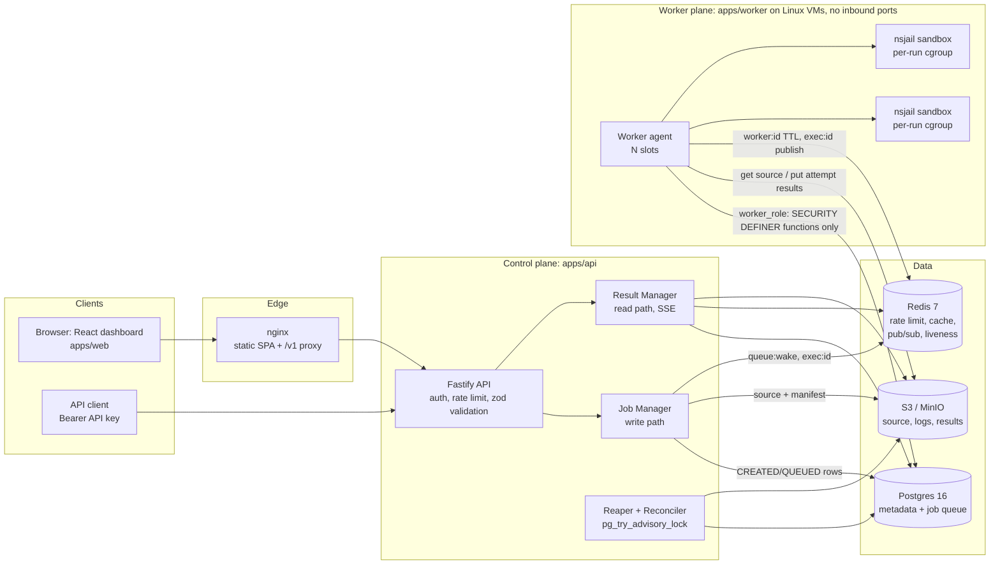
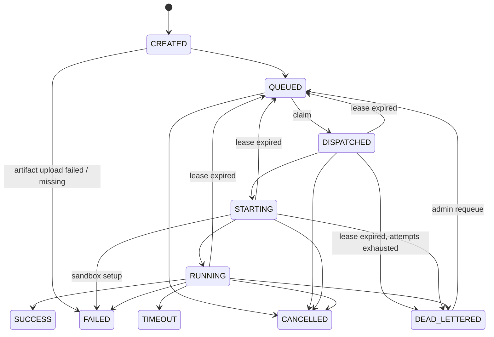

# Architecture

A multi-tenant code execution engine. Clients submit source plus limits. The platform stores the source in S3, queues
a job in Postgres, and a worker runs it inside an nsjail sandbox (Linux namespaces, cgroup v2, seccomp-bpf, rlimits,
no network). Results go to S3, metadata to Postgres, and clients read everything through the API or the React
dashboard.

The isolation model is **layered isolation and resource containment**. The host kernel stays in the trusted computing
base; see [SECURITY.md](SECURITY.md).

## System diagram



Clients never talk to workers, and workers never talk to clients. Workers only make outbound connections, to
Postgres, Redis and S3.

## Components

### API: control plane (`apps/api`)

- **Gateway concerns** (`src/app.ts`): helmet headers, a CORS allowlist (`WEB_ORIGIN`, with credentials), a 2.5 MB
  body limit, JSON only (anything else returns 415), `X-Request-Id` propagation, and pino logs that record ids and
  sizes only.
- **Auth** (`src/auth/`):
  - Dashboard sessions are an HS256 JWT in the httpOnly SameSite=Lax `session` cookie (Secure when
    `COOKIE_SECURE=true`).
  - The JWT carries a `csrf` claim. State-changing requests that use the cookie must echo that value in an
    `x-csrf-token` header (signed double submit).
  - API keys have the form `ce_live_<prefix>_<secret>`. Only `sha256(secret)` is stored, compared in constant time,
    and cached in Redis for 60s keyed by prefix. Revoking a key invalidates the cache entry.
  - Passwords are hashed with argon2id (`@node-rs/argon2`).
- **Job Manager** (`src/jobManager.ts`): the write path, described below.
- **Result Manager** (`src/routes/executions.ts`, `src/events.ts`): the read path, the SSE stream and cancellation.
- **Reaper and Reconciler** (`src/reaper.ts`):
  - Runs every `REAPER_INTERVAL_MS` (default 10s) on whichever API instance wins `pg_try_advisory_lock(727001)` on a
    dedicated connection.
  - Each pass:
    1. Expired leases go back to `QUEUED` with backoff, or to `DEAD_LETTERED`.
    2. `CREATED` rows stuck for more than 60s become `QUEUED` if the source manifest exists, otherwise `FAILED`
       with `artifact_missing`.
    3. Recomputes `tenant_concurrency` from the actual rows.
    4. Marks workers with no heartbeat for 30s as `dead`.
    5. Retention: deletes the S3 prefix and the row for terminal executions older than `RETENTION_DAYS`.
  - An S3 lifecycle rule is the retention backstop; `scripts/init-infra.ts` installs it.
- **Ops endpoints:** `/healthz`, `/readyz` (Postgres, Redis and S3), `/metrics` (Prometheus) and `/docs` (OpenAPI JSON
  generated from the shared zod schemas).

### Worker plane (`apps/worker`, `packages/sandbox`)

- Startup:
  1. Validate the environment with zod.
  2. Run the **sandbox self-test**: the nsjail binary and its pinned version (3.4), cgroup v2 delegation, a rootfs for
     each language, a hello world per language (C and C++ only compile), a network egress probe that must fail, and a
     contained fork-bomb probe.
  3. If any check fails, exit with code 2.
- The worker then runs `WORKER_SLOTS` slot loops (`src/slot.ts`) and a heartbeat that upserts the `workers` row and
  sets the Redis key `worker:{id}` (TTL 15s, includes busy and slots).
- On SIGTERM the worker drains:
  1. Stop claiming and mark the worker `draining`.
  2. Wait up to `DRAIN_SECONDS` for running jobs.
  3. Kill any sandboxes still running. Their leases expire and the reaper requeues them.

### Data services

- **Postgres** holds metadata only: tenants, users, API keys, executions, attempts, events, workers and tenant
  concurrency. Source code and logs are never stored there. Migrations live in `packages/db/migrations/*.sql` and run
  through node-pg-migrate.
- **Redis** is advisory only. Every Redis call in the API goes through a `safe()` wrapper, and the worker swallows
  Redis errors. It is used for:
  - the token-bucket rate limit (`rl:{tenant}`)
  - the status cache (`exec:{tenant}:{id}`: 2s while active, 1h once terminal, plus a 1h `:stale` copy used during
    Postgres outages)
  - the API key cache
  - pub/sub on `exec:{id}` (status events) and `queue:wake` (claim hint)
  - worker liveness (`worker:{id}`)
  - the fenced-result counter
- **S3** keys are built only in `packages/shared/src/keys.ts`; clients never choose them:

  ```
  tenants/{tenantId}/executions/{id}/source/files/{path}
  tenants/{tenantId}/executions/{id}/source/stdin
  tenants/{tenantId}/executions/{id}/source/manifest.json   # written last: sizes + sha256 of every file and stdin
  tenants/{tenantId}/executions/{id}/attempts/{n}/stdout.log
  tenants/{tenantId}/executions/{id}/attempts/{n}/stderr.log
  tenants/{tenantId}/executions/{id}/attempts/{n}/result.json
  ```

  Result keys include the attempt number, so a late duplicate attempt can never overwrite the authoritative result.

## Job queue

The queue is the `executions` table. `PgJobQueue` (`packages/db/src/queue.ts`) implements the `JobQueue` interface so
a broker could replace it later. Workers connect as a member of **`worker_role`**, which has no table privileges at
all. They can only call the SECURITY DEFINER functions in
`packages/db/migrations/1730000000001_worker-functions.sql`, with `worker_complete` replaced in `…0002`:

| Function | Effect |
|---|---|
| `worker_register` | Upsert the `workers` row. |
| `worker_claim(worker, lease)` | Selects `QUEUED` rows with `available_at <= now()` using `FOR UPDATE OF e SKIP LOCKED`, skipping tenants at `max_concurrent`. Orders by priority, then the tenant dispatched least recently (fairness), then `created_at`. Takes a concurrency slot with a guarded `UPDATE tenant_concurrency … WHERE running < max_concurrent`, sets `DISPATCHED`, `attempt+1`, the lease owner and the lease expiry, and inserts the attempt and event rows. One transaction. |
| `worker_heartbeat` | Extends the lease where `id`, `lease_owner` and `attempt` match. Returns `cancel_requested`; zero rows means the lease was lost. |
| `worker_advance` | Allows only `DISPATCHED→STARTING` and `STARTING→RUNNING`, fenced, with an event row. |
| `worker_complete` | Fenced on `id`, `attempt`, `lease_owner`, an **unexpired lease** (`lease_expires_at >= now()`) and an active status. Writes the result columns, closes the attempt row, releases the tenant slot and inserts the event. Returns false when the attempt lost authority. |

API-side transitions all go through `transitionExecution` (`packages/db/src/transition.ts`). It does a
compare-and-set `UPDATE … WHERE status = ANY(expected)`, with optional fences on tenant, attempt and
`lease_expires_at < now()`. It inserts the event row in the same transaction, releases the tenant slot when the job
leaves an active state, and then runs an after-commit hook. The hook publishes to `exec:{id}` and invalidates the
cache.

Tenant data access in the API goes through tenant-scoped repositories (`ExecutionRepo` and `ApiKeyRepo`, both
constructed with a `tenantId`). Cross-tenant queries live only in `PlatformRepo`, which is used by admin routes,
metrics and the reaper.

## State machine (`packages/shared/src/states.ts`)



- `FAILED` always means the user's program failed or the sandbox setup failed. It is final and is never retried.
- Infrastructure failures, such as a lease expiring, go back to `QUEUED` with a 5s, 20s or 60s backoff, until
  `attempt >= max_attempts`, at which point the job becomes `DEAD_LETTERED`.

## Write path (`POST /v1/executions`)

1. Authenticate with the session cookie plus CSRF, or with a Bearer API key, and load the tenant.
2. Rate limit with a Redis token bucket at `max_exec_per_min`. If Redis is down, fall back to an in-memory bucket at
   half the rate per instance. Over the limit: `429` with `Retry-After`.
3. Validate with zod: language, safe paths (no `..`, absolute paths, NUL or backslash), at most 20 files, source size
   against `max_source_bytes` (413 if over), stdin up to 256 KB, and limits through `resolveLimits`. Limits over a cap
   are rejected with 400 `limit_exceeded`, never silently clamped.
4. Idempotency: the same key with the same `request_hash` returns the existing execution with 200. A different hash
   returns 409. A tenant with 200 queued jobs gets 429 `queue_full`.
5. Insert the `CREATED` row and its event.
6. Upload the files, stdin and finally `manifest.json` to S3, with retries. If the upload still fails, transition to
   `FAILED` (`artifact_upload_failed`) and return 503.
7. Transition `CREATED → QUEUED`, publish `queue:wake`, and return `202 {id, status}`.

Concurrency quotas are enforced at claim time, not on submit.

## Worker execution path (one slot)

1. **Claim:** call `worker_claim`. If there's nothing to do, sleep for a jittered poll interval, or wake early on
   `queue:wake`.
2. **Heartbeat** every `HEARTBEAT_SECONDS`:
   - If the lease was lost, abort the sandbox and discard the result.
   - If `cancel_requested` is set, abort and complete as `CANCELLED`.
3. **Start:** `DISPATCHED→STARTING`.
   - Create `/var/lib/worker/runs/{id}-{attempt}` with mode 0711. When the worker runs as root, the workspace inside
     it is a per-run 128 MB tmpfs owned by the slot's sandbox uid.
   - Download the manifest and the files, and verify each file's size and sha256.
   - If the source is missing or corrupt, stop heartbeating and leave the job to lease expiry. That is an
     infrastructure failure, so it is retried.
4. **Run:** `STARTING→RUNNING`. C and C++ compile first (wall 10s, memory 512 MB). A compile failure becomes
   `FAILED/compile_error` with the compiler output as stderr. Then the program runs with the tenant's limits.
5. **Upload:** put stdout, stderr and `result.json` under `attempts/{n}/`, with retries. If the upload still fails,
   stop heartbeating and leave the job to lease expiry.
6. **Complete (fenced):** call `worker_complete`. If it returns false, delete this attempt's S3 prefix and increment
   `metrics:fenced_results_discarded_total`.
7. **Cleanup** in `finally`: kill the run's cgroup, unmount the workspace tmpfs, and remove the run directory.

Result mapping (`apps/worker/src/result-mapping.ts`), most specific cause first:

| Cause | Status | `failure_reason` |
|---|---|---|
| Cancelled | `CANCELLED` | — |
| Sandbox setup error | `FAILED` | `sandbox_setup_error` |
| Wall time exceeded | `TIMEOUT` | — |
| cgroup `oom_kill` | `FAILED` | `oom` |
| SIGSYS (seccomp) | `FAILED` | `seccomp_violation` |
| Compile failed | `FAILED` | `compile_error` |
| Exit 0 | `SUCCESS` | — |
| Killed by a signal | `FAILED` | `killed_by_signal` |
| Any other non-zero exit | `FAILED` | `runtime_error` |

## Sandbox (`packages/sandbox`)

`NsjailDriver` renders a protobuf-text config for each run (`nsjail-config.ts`, using nsjail 3.4 field names) and a
kafel policy (`seccomp.ts`, combining `base.kafel` with an optional per-language addition). It then runs:

```
/bin/sh -c 'echo $$ > "$1" && shift && exec "$@"' sh <cgroup.procs> nsjail --config <file>
```

The wrapper script is a constant. Every value is passed as argv, never interpolated into shell text. The wrapper puts
nsjail and all of its descendants into a **cgroup that the worker owns** (`cgroup.ts`: memory.max, memory.swap.max=0,
pids.max and cpu.max). That lets the worker read `memory.peak`, `memory.events` (`oom_kill`) and `cpu.stat`, and kill
every descendant with `cgroup.kill`.

Wall time is enforced twice: nsjail's `time_limit` (rounded up to whole seconds), and a worker watchdog that fires
after the wall limit plus 1.5s. stdout and stderr go through pipes into files capped at 1 MB each. Output beyond the
cap is drained and discarded so the program can't block on a full pipe.

`DockerDriver` is the dev-only fallback for machines without nsjail. It uses `docker run --network none --read-only
--cap-drop ALL …`, refuses to construct when `NODE_ENV=production`, and the worker prints a "DEV ONLY" warning when it
is selected.

## Read path

- `GET /v1/executions/:id`: checks the Redis cache, then the read replica (`DATABASE_READ_URL`), falling back to the
  primary.
- `GET /v1/executions`: a cursor-paginated list.
- `/logs`: a 60s presigned URL, or `?inline=true` to stream up to 1 MB as text/plain with an `X-Truncated` header.
- `/result`: the parsed `result.json`.
- `/source`: used by the dashboard's Re-run button.
- `/events`: SSE, cookie sessions only. Sends the current state, then pushes updates from Redis pub/sub with a 2s
  polling fallback and a `: ping` every 15s, and closes on a terminal state.
- `/cancel`: transitions `QUEUED → CANCELLED`; for an active job it sets `cancel_requested` and returns 202.
- Other tenants' ids return `404`.

## Known limitations

- **TCB:** the host kernel is part of the trusted computing base. A kernel bug reachable through the allowed syscalls
  could break isolation. Future work is gVisor or Firecracker microVMs.
- **Dev compose privileges:** the compose `worker` runs `privileged: true` with a private cgroup namespace, so nsjail
  can create namespaces and manage cgroups inside Docker Desktop. A production worker runs as a systemd service on a
  dedicated VM (`infra/worker-vm/`).
- **Worker runs as root.** It needs to set arbitrary uid maps, mount per-run tmpfs and write cgroups. User code never
  runs as root; it runs as uid 65534, mapped to host uid 200000+slot, with no capabilities and `no_new_privs`.
- **tsx in images:** the API and worker images run TypeScript through `tsx` instead of compiled JS, and install dev
  dependencies.
- **Unpinned MinIO:** `cgr.dev/chainguard/minio:latest` is used for local S3 because Docker Hub no longer serves
  `minio/minio`. It cannot be pinned on the free tier.
- **Exit codes above 128:** nsjail reports a signalled child as exit code 128+N, so the driver maps exit codes 129–192
  to signals. A program that calls `exit(137)` itself is reported as killed by SIGKILL.
- **Whole-second time limit:** nsjail's `time_limit` is in whole seconds. Sub-second precision comes only from the
  measured `wallMs` and the watchdog, which fires at the wall limit plus 1.5s.
- **Node RLIMIT_AS:** Node gets a 16 GB address-space rlimit because V8 reserves large virtual ranges at startup.
  Other runtimes get 4×memory+1 GB. cgroup `memory.max` is the effective memory limit.
- **DockerDriver:** OOM is inferred from exit code 137 without a timeout, there are no CPU or peak-memory stats, and
  workspace paths must be valid on the docker host.
- **Run directory mode:** per-run directories are mode 0711, not the 0700 in the spec, because nsjail bind-mounts the
  workspace from inside the new user namespace, which needs search permission on the parent directories.
- **Single instances:** one Postgres primary (optional read replica) and one Redis; no clustering. Autoscaling is
  documented ([RUNBOOK.md](RUNBOOK.md)), not implemented.
- **API DB role:** the API connects as the database owner (a superuser in the dev compose). Only workers use the
  restricted `worker_role`.
- **Worker transitions:** worker-side transitions run in SQL functions, not through the TypeScript
  `transitionExecution`, so the allowed worker transitions are encoded twice: once in `states.ts` and once in the SQL.
- **Wake-up hint:** the `queue:wake` hint wakes only one waiting slot per worker process (`Hints.waitForWork` keeps a
  single waiter). The other slots fall back to polling, which stays the source of truth.
- **IMDSv2:** IMDSv2 with hop limit 1 has to be set through the cloud API. `setup.sh` only documents the command.
- **Seccomp profile:** the kafel policy was built for Python 3.12, Node 20 and GCC 13 on x86_64 and validated by the
  self-test and the abuse suite. A different runtime version may need policy additions.
